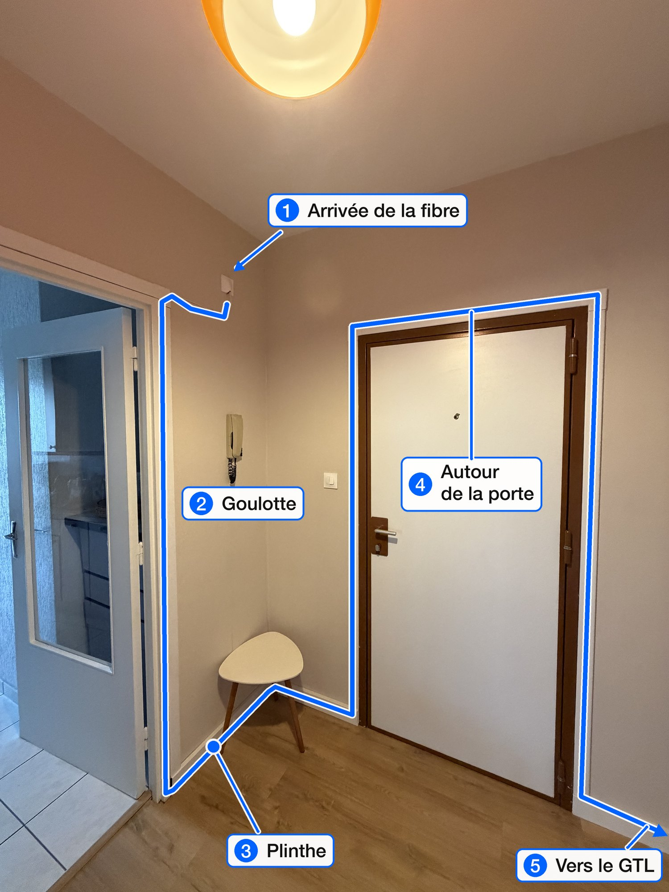
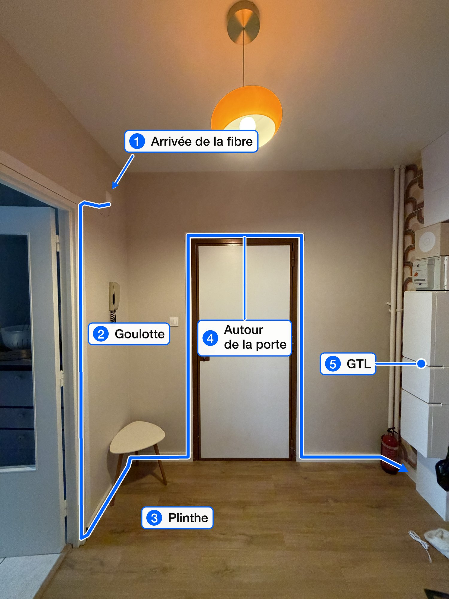
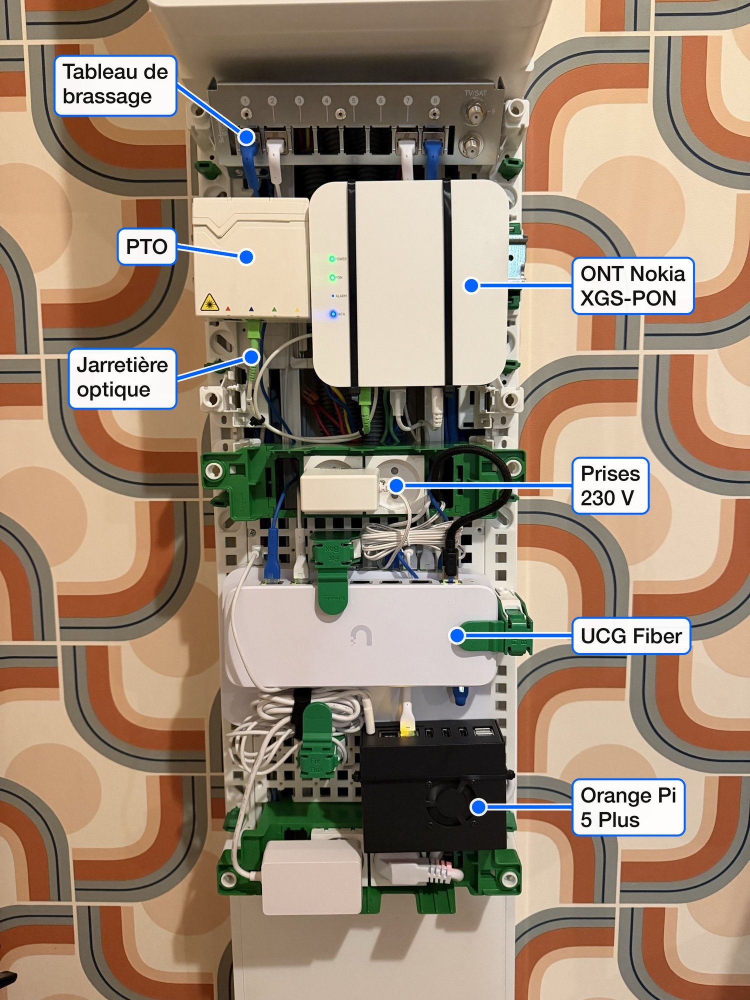
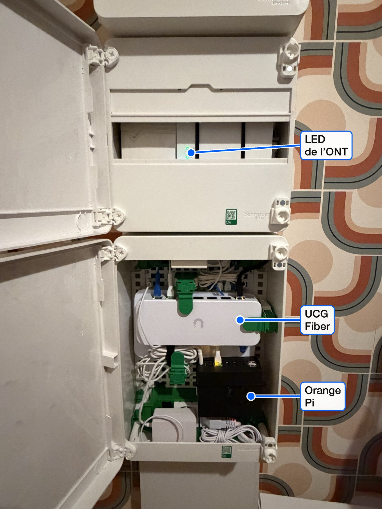

**Cet article n'est pas sponsorisé.** Personne ne m'a payé pour citer ces marques, et aucun lien n'est affilié.

Ce setup fibre est celui que je recommanderais fin 2026 à un fana de tech, par exemple un ingénieur en full remote. Il n'était pourtant pas prévu : au départ, je voulais juste changer d'offre.

## Le déclic : Pure Fibre

Tout est parti d'une annonce. [Bouygues Telecom](https://www.bouyguestelecom.fr/) a sorti [B&You Pure Fibre](https://www.bouyguestelecom.fr/offres-internet/byou-pure-fibre), une offre fibre seule, sans TV ni téléphone fixe. Exactement ce dont j'avais besoin, et rien de plus.

À ce moment-là, j'étais chez [Free](https://www.free.fr/) avec une [Freebox Delta](https://fr.wikipedia.org/wiki/Freebox), sans la TV, pour environ 50 € par mois. Ça marchait, mais c'était cher pour ce que j'en faisais, et le serveur Delta est un gros boîtier qui ne rentre dans aucun placard technique. J'ai voulu changer.

J'ai pris la version Plus : 8 Gb/s en descendant, 1 Gb/s en montant, sans engagement, affichée à 27,99 € par mois à l'été 2026.

## Se passer de la box

En faisant des recherches, je me suis rendu compte que c'était possible de se passer de la box.

Une box opérateur fait tout à la fois : convertisseur fibre, routeur, Wi-Fi. Avec cette offre, on peut demander un ONT seul, qui ne fait que convertir la fibre en Ethernet. Il restait donc à choisir ce qui remplacerait le reste :

- **Un routeur à soi.** Une [UniFi Cloud Gateway Fiber](https://store.ui.com/eu/en/products/ucg-fiber), avec un port WAN à 10 GbE. C'est elle qui décide de ce qui entre et de ce qui sort, et elle ne change pas si je change d'opérateur.
- **Le Wi-Fi à part.** Un point d'accès enfermé dans une gaine technique arrose surtout le mur. Le mien est dans une autre pièce, alimenté par le câble Ethernet grâce au [PoE](https://fr.wikipedia.org/wiki/Power_over_Ethernet).

## De l'arrivée de la fibre au coffret

La fibre n'arrivait pas au bon endroit. Elle entre dans l'appartement en haut à gauche de l'entrée, alors que le coffret de communication est de l'autre côté de la pièce. Pour éviter un câble apparent, j'ai monté des goulottes : elles font le tour de la première porte, passent dans les plinthes, repartent autour de la porte d'entrée et continuent jusqu'au GTL.





Le GTL, c'est la gaine technique logement : l'emplacement qui regroupe le tableau électrique et le [coffret de communication](https://www.se.com/fr/fr/faqs/FAQ000276664/). Chez moi, c'est une colonne [Schneider Electric Resi9](https://www.se.com/fr/fr/about-us/newsroom/news/press-releases/schneider-electric-pr%C3%A9sente-resi9-son-tableau-%C3%A9lectrique-universel-connect%C3%A9-et-s%C3%A9curis%C3%A9-de-nouvelle-g%C3%A9n%C3%A9ration-59c384d961cb7d6b258b4687/), avec un tableau de brassage de 8 ports RJ45, deux prises 230 V et une grille perforée sur laquelle on fixe les boîtiers avec des clips « Fix Box ».

## Le matériel



| Équipement                                                                                                          | Rôle                                                                                                |
| ------------------------------------------------------------------------------------------------------------------- | --------------------------------------------------------------------------------------------------- |
| PTO                                                                                                                 | arrivée de la fibre dans le coffret                                                                 |
| ONT Nokia (fourni par Bouygues)                                                                                     | convertit la fibre [XGS-PON](https://fr.wikipedia.org/wiki/10G-PON) en Ethernet 10 Gb/s             |
| [UniFi Cloud Gateway Fiber](https://store.ui.com/eu/en/products/ucg-fiber) (UCG Fiber)                              | routeur, pare-feu, DHCP et contrôleur [UniFi](https://ui.com/)                                      |
| [Orange Pi 5 Plus](http://www.orangepi.org/html/hardWare/computerAndMicrocontrollers/details/Orange-Pi-5-plus.html) | serveur maison : [Docker](https://www.docker.com/), Coolify, ce blog                                |
| [UniFi Switch Ultra](https://store.ui.com/eu/en/products/usw-ultra) (USW Ultra)                                     | petit switch dans une autre pièce, alimenté en PoE par la passerelle                                |
| [UniFi U7 Long-Range](https://store.ui.com/eu/en/products/u7-lr)                                                    | point d'accès [Wi-Fi 7](https://fr.wikipedia.org/wiki/IEEE_802.11be), alimenté en PoE par le switch |

La pièce centrale est la UCG Fiber. Elle a un port WAN RJ45 à 10 GbE, deux cages SFP+ à 10 Gb/s et quatre ports 2,5 GbE, dont un en PoE+. Elle tient à plat dans le coffret, avec deux clips, et fait tourner l'application UniFi Network, donc pas besoin d'un contrôleur à part.

L'ONT est un petit boîtier Nokia avec quatre LED (alimentation, PON, alarme, données), une entrée fibre et une sortie Ethernet. Il se pose à côté de la PTO, relié par une courte jarretière optique.



Une fois le plastron remis, il ne reste que les LED de l'ONT, et la porte du coffret ferme.

## La configuration Bouygues

Sans Bbox, c'est la passerelle qui reçoit directement l'adresse IPv4 publique. Il faut qu'elle se présente au réseau Bouygues comme une Bbox. Tout se règle dans l'interface UniFi, sans SSH. J'ai suivi le récapitulatif de [lafibre.info](https://lafibre.info), où les abonnés qui remplacent leur box partagent ce qui marche.

| Paramètre   | Valeur                                            |
| ----------- | ------------------------------------------------- |
| VLAN        | 100                                               |
| Adresse MAC | celle de la Bbox, clonée                          |
| IPv4        | DHCP, vendor class (option 60) `BYGTELIAD`, CoS 6 |
| IPv6        | DHCPv6, CoS 6, délégation de préfixe en `/60`     |

Je n'y suis pas arrivé du premier coup. Pendant quelques jours, la Bbox est restée dans le circuit, avec la passerelle UniFi dans sa DMZ. Ça marchait, mais avec deux routeurs qui font du NAT l'un derrière l'autre, et deux réseaux qui démarrent tous les deux en `192.168.1.x`. Avec l'ONT, il n'y a plus qu'un seul routeur. La Bbox est dans un tiroir, au cas où.

## La forme du réseau

Tout part de la passerelle. Le réseau est volontairement simple : un seul LAN en `192.168.1.0/24`, la passerelle en `.254`.

```text
            Bouygues Telecom, XGS-PON
            8 Gb/s descendant, 1 Gb/s montant
                       |
                       |  fibre
                       v
+-- GTL, coffret de communication Resi9 ---------------+
|                                                      |
|   PTO --jarretière--> ONT Nokia                      |
|                          |                           |
|                          |  10 GbE, VLAN 100         |
|                          v                           |
|   UniFi Cloud Gateway Fiber           192.168.1.254  |
|     port 3, 2,5 GbE -> Orange Pi 5 Plus  .10         |
|     ports 1 et 2    -> prises murales -> PC          |
|     port 4, PoE+    -> prise murale ---------+       |
|                                              |       |
+----------------------------------------------+-------+
                                               |
                       câble dans le mur, PoE  |
                                               v
                               UniFi Switch Ultra  .102
                                 port 1, PoE
                                               |
                                               v
                               U7 Long-Range       .159
                               Wi-Fi 2,4 et 5 GHz
```

Le switch et le point d'accès n'ont pas de bloc d'alimentation : la passerelle alimente le switch en PoE+, et le switch alimente le U7 Long-Range à son tour. Au total, la passerelle fournit environ 8 W sur les 30 W de son budget PoE.

Le U7 Long-Range diffuse deux réseaux Wi-Fi :

- le réseau principal, en 2,4 et 5 GHz, en WPA2/WPA3 ;
- un réseau IoT, en 2,4 GHz seulement et en WPA2, pour les objets connectés qui ne savent pas faire mieux : robot aspirateur, imprimante, chauffe-eau.

En 5 GHz, il émet sur un canal de 160 MHz. C'est large pour un immeuble, mais l'interface UniFi note l'expérience Wi-Fi comme excellente. Au moment où j'écris, une quinzaine d'appareils y sont connectés.

Pour l'instant, les deux réseaux Wi-Fi arrivent dans le même LAN. Mettre l'IoT dans un VLAN séparé, avec des règles de pare-feu entre les deux, est la prochaine étape.

## Héberger chez soi sans ouvrir de port

C'est le bonus d'avoir son propre réseau. L'Orange Pi est branché en 2,5 GbE sur la passerelle, juste en dessous d'elle dans le coffret. Il fait tourner [Coolify](https://coolify.io) et plusieurs applications, dont ce blog.

Pour les rendre accessibles depuis Internet, je n'ouvre aucun port sur le routeur. L'Orange Pi lance [`cloudflared`](https://developers.cloudflare.com/tunnel/), qui ouvre une connexion **sortante** vers [Cloudflare](https://www.cloudflare.com/fr-fr/). Les visiteurs arrivent chez Cloudflare, et leurs requêtes redescendent par ce tunnel.

```text
visiteur
   |  https://mat.bour.io
   v
Cloudflare (DNS *.bour.io, TLS, protection DDoS)
   ^
   |  tunnel ouvert depuis la maison, aucun port entrant
   |
UCG Fiber (pare-feu fermé en entrée)
   |
Orange Pi 5 Plus : cloudflared -> proxy Coolify -> applications
```

Ça a plusieurs avantages :

- le pare-feu de la passerelle reste fermé en entrée ;
- mon adresse IP publique n'apparaît nulle part dans le DNS ;
- si l'adresse change, rien à faire, le tunnel se reconnecte tout seul ;
- un enregistrement DNS `*.bour.io` pointe vers le tunnel, donc une nouvelle application n'a besoin que d'un nom de domaine dans Coolify.

Le détail du pipeline, de la construction de l'image jusqu'au déploiement, est dans [How this blog is built](/posts/how-this-blog-is-built/) (en anglais).

## Le bilan

- **Moins cher.** Je payais environ 50 € par mois chez Free.
- **Le débit est là.** 8 Gb/s en descendant et 1 Gb/s en montant, avec un port WAN à 10 GbE et un serveur en 2,5 GbE pour en profiter.
- **Rangé.** La fibre, l'ONT, le routeur et le serveur tiennent dans le coffret de communication, et on ne voit plus de câble.
- **Une seule interface.** La passerelle, le switch et le Wi-Fi se gèrent depuis la même application UniFi, chez moi ou à distance.

Ce setup a quand même ses limites. Les 8 Gb/s dépendent de l'éligibilité au XGS-PON, il faut acheter son matériel, et il faut être prêt à passer une soirée sur la configuration. Si vous voulez la TV ou le téléphone fixe sans y penser, une box reste plus simple. Si vous voulez un réseau qui vous appartient, c'est celui que je vous conseillerais.
