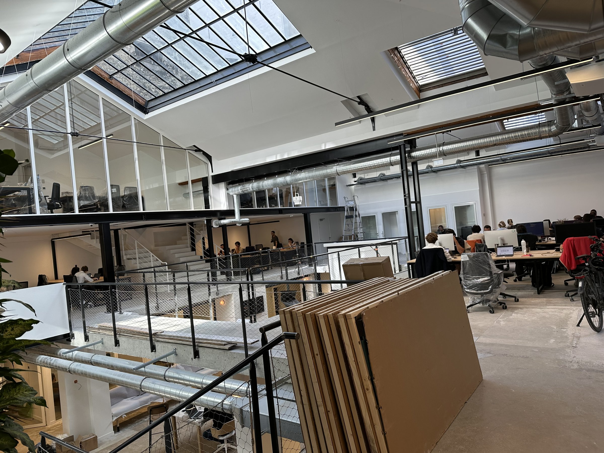
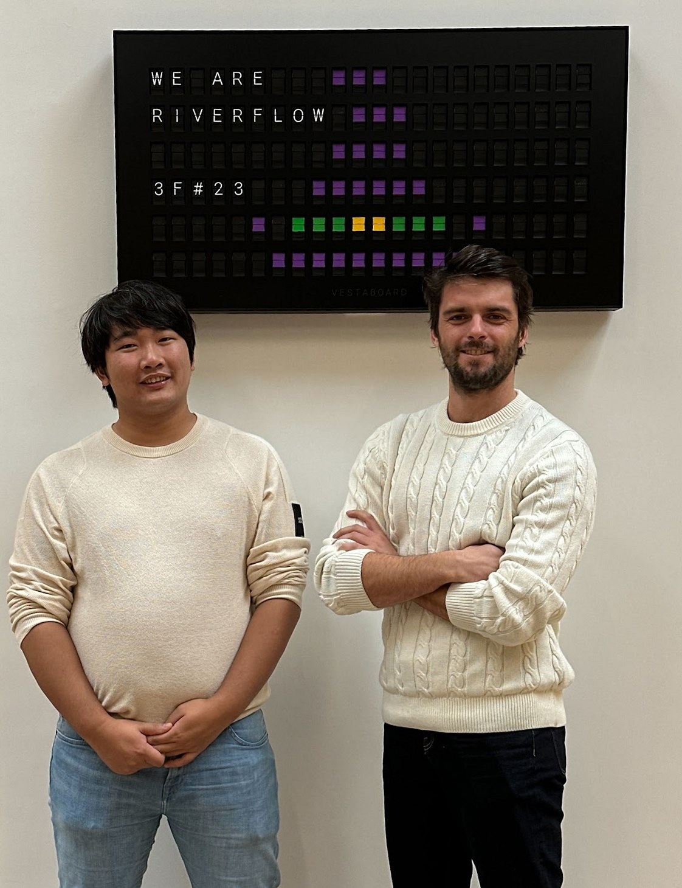

Between 2023 and 2024 I was the co-founder and CTO of [Riverflow](/experience/), a blockchain data startup built inside [Hexa](https://hexa.com), the startup studio behind Front, Spendesk and Aircall. It lasted less than a year before the team joined Mobula. The product was the reason we were there, but the people are what I remember most.

## A message out of nowhere

On June 13, 2023, I was writing smart contracts at [Pooky](/experience/) when a stranger wrote to me on LinkedIn. [Ludovic Simon](https://www.linkedin.com/in/simonludovic/) was starting a web3 project with a strong tech and data side, with Hexa, and he was looking for a co-founder and CTO. Did I want to talk?

A cold message from someone I had never met, for a company that didn't exist yet: it was a little strange. But I replied within a minute that I was, as it happened, looking to start something myself. We had a call that same afternoon, right after a release I had to ship.

A week later I had a call with [Florent Quinti](https://www.linkedin.com/in/florentquinti/). Ludovic wrote the next morning: it had gone very well, and Florent had suggested I come to Paris so we could meet in person. On June 28 I took the train, had lunch with Ludovic, and spent the afternoon at Hexa. I had already pushed the first commit of the Riverflow platform six days earlier.

## 3founders

Florent is a partner at Hexa. He had launched [3founders](https://www.hexa.com/blog/news/a-second-studio-is-born-3founders), Hexa's studio for web3 startups, and that's where Riverflow was built. 3founders has since closed, but for a while it was a place where a small team could get serious backing to try an idea.

I owe Florent more than I can fit in a paragraph. He's an exceptional person, and one of the people I'm most grateful to from those years.

[Thibaud Elzière](https://www.linkedin.com/in/thibaud-elziere/), who co-founded eFounders (now Hexa), trusted me too. When you've never founded a company, being backed by the person whose studio started Front, Spendesk and Aircall is something you don't forget.

## Scrappy offices

Hexa's offices, La Cristallerie, near the Poissonnière metro station in Paris, were in the middle of renovation work. It was scrappy, and it was great. Building a startup in a building that was itself being rebuilt felt about right.

## The people

I worked a lot, and I mean a lot, with [Médéric Manière](https://www.linkedin.com/in/m%C3%A9d%C3%A9ric-mani%C3%A8re-315a90ba/), Hexa's founding designer, who designed Riverflow.

On the engineering side, [Valentin Pollart](https://github.com/valentinpollart) joined in October 2023. Of the 1,117 commits on the platform, 712 are mine and 402 are his. In March 2024, [Sylvain Coulomb](https://www.linkedin.com/in/sylvain-coulomb/) came in to explore what AI could do with blockchain data.

## What we built

Riverflow pulled activity from the main EVM chains (Ethereum, Polygon, Avalanche, Arbitrum) and routed it to webhooks, data warehouses and SaaS tools. Hexa [introduced it](https://hexa.com/blog/article/were-launching-riverflow-to-finally-make-blockchain-data-actionable) in October 2023 as a way to make blockchain data actionable across teams, and [TechCrunch](https://techcrunch.com/2023/10/30/hexa-the-startup-studio-behind-front-spendesk-and-aircall-unveils-its-next-batch-of-startups/) described it as "more like Segment than Zapier".

## Meeting Sacha

Along the way I met [Sacha Marcus](https://www.linkedin.com/in/sacha-marcus/), the founder of [Mobula](https://mobula.io). He's one of the best entrepreneurs I know, and we got along almost immediately. In April 2024 Mobula acqui-hired Riverflow: the technology and every engineer on the team moved over, and I became Mobula's CTO. That chapter is its own story.
